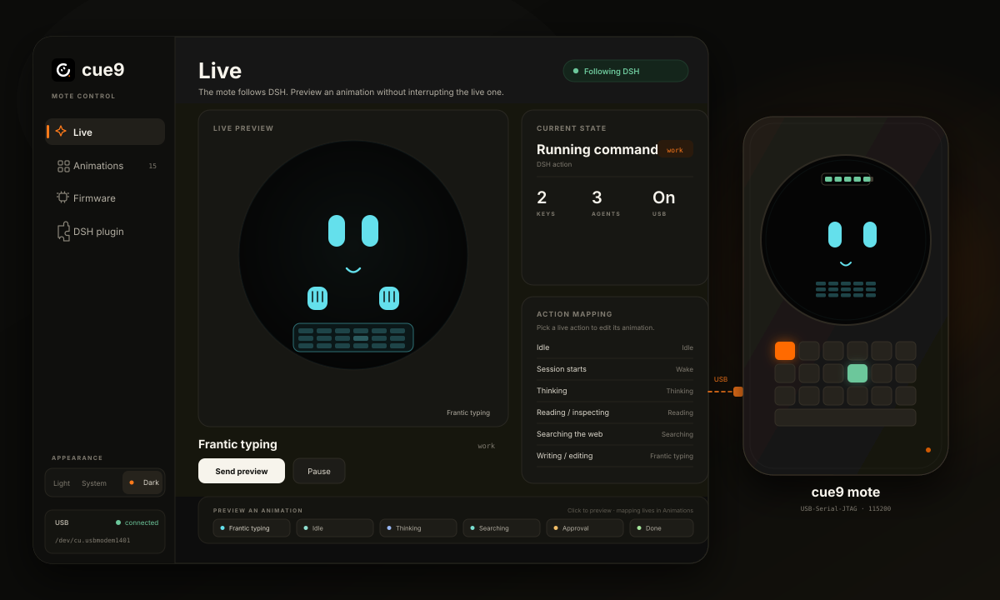

#  cue9 mote

**A headless DeepSeek Harness plugin that makes a cue9 desk mote follow your agents.**

`dsh-cue9-mote` runs inside DSH's Host, listens to activity across every workspace,
and streams an animation to the mote over USB. The mote is the small cue9 device:
a round screen for Pip, the cat, and a 19-key light strip under it. The cat follows
the first working agent, and each extra running session or subagent lights a key.
A pending approval or blocking question latches the display until you answer it.

The plugin is the DSH half. The cue9 macOS app is the optional control surface for
previewing actions, editing the action → animation mapping, and flashing firmware.



## What it does

- **Follows the work.** Turn starts, tool calls, subagent waits, errors, workflow
  completions, and finished turns map to one of 15 cat animations. The mapping lives
  on the Mac, so changing it never reflashes the mote.
- **Lights the extras.** The cat represents the first running agent. Each additional
  running session or subagent lights one keyboard key, up to the mote's 19 slots.
- **Holds blockers.** A pending approval or blocking question latches across sessions;
  ordinary events keep updating in the background but do not take over the display.
  Approval wins when both are pending.
- **Keeps the link.** The bridge finds `/dev/cu.usbmodem*`, reconnects if the board
  disappears, and sends a 1 Hz heartbeat. Without it, the mote falls back to `hub`.
- **Stays local.** No network calls, no accounts, no DSH sidebar. Its only device
  output is the USB serial link.

## How it fits together

DSH events → action → animation → `usb_bridge.py` → USB-Serial-JTAG → mote.

The plugin starts in live mode. The app's **Live** page can hold a preview and then
**Resume DSH**; a new DSH action also takes over. `~/.dsh/cue9/mapping.json` holds the
mapping. An empty animation list pushes nothing and leaves the current scene up.

## Install

You need macOS, DSH, Python 3 with `pyserial`, and a flashed cue9 mote. The cue9 app
is optional.

1. Install the bridge dependency for the interpreter the plugin uses:

   ```sh
   /usr/local/bin/python3 -m pip install pyserial
   ```

   The default is `/usr/local/bin/python3`; set `CUE9_PYTHON` to use another Python 3.
2. In DSH, open **Plugins → Add plugin** and choose this folder (or its Git URL once
   the repo is published).
3. Enable **cue9 mote** and connect the mote over USB. There is no activation step;
   the bridge connects on its own.
4. Open the cue9 app's **DSH plugin** page to confirm DSH and USB are connected, then
   use **Live** or **Animations**. Without the app, the default mapping still runs.

## Use it

- **Preview:** on **Live**, pick an action and press **Send preview**. **Resume DSH**
  returns to the live target.
- **Remap:** on **Animations**, give an action one or more animations. More than one
  cycles every 8 seconds. Mapping edits apply without a reflash.
- **Flash:** the app releases the USB bridge before flashing and reconnects it after.
  If you flash from a terminal instead, disable **cue9 mote** first so the bridge is
  not holding the port.
- **Environment:** `CUE9_PORT` pins a serial port, `CUE9_PYTHON` picks the interpreter,
  and `CUE9_DISABLE_USB=1` starts the plugin without the bridge.

## Limits

- macOS desktop only: the bridge owns a local USB serial device.
- One mote per DSH Host. The bridge holds the port, so a second process cannot use it.
- 19 keys is the hardware cap. The plugin counts every running agent but clamps the
  serial `AGENTS` command to 19.
- The mapping and palette files are the only state. Removing the plugin leaves
  `~/.dsh/cue9/` behind.
- The app talks to the plugin through DSH's local web server. POST routes require the
  fixed `x-cue9-action: 1` header; there is no separate login.

## Technical notes

- **Events:** `session/event` (`turn/start`, `turn/end`), `tools/pre-execute`,
  `approval/request`, `user-questions/request`, `subagent/start`/`end`, workflow
  events, and a 500 ms `ctx.get('agents').list()` poll. The poll is the authority for
  the key count; it sees every workspace.
- **One active session:** the first session to trigger becomes the animation target;
  other sessions' actions are ignored until it ends, while their agents still count
  toward keys.
- **Serial protocol:** `ANIM <state>`, `AGENTS <n>`, `ALIVE`, `DEMO`, `REFRESH`, and
  `PING` in; JSON status lines out. The bridge sets DTR/RTS low on open and close so it
  does not hold the ESP32 in reset.
- **Done beat:** `done` holds for 2.5 seconds before `idle`. The scene is refreshed
  when its sequence ends (`work` 15 s, others 6 s) without reconnecting or power-cycling
  the panel.
- **Routes:** `GET /plugins/cue9/state`, plus POST routes for `mapping`, `preview`,
  `live`, `reconnect`, `palette`, `usb`, and `demo`. The cue9 app uses the state,
  mapping, preview, live, usb, and palette routes.
- **Files:** `~/.dsh/cue9/mapping.json` and `~/.dsh/cue9/palette.json`, written
  atomically.

## Assets

`icon.svg` is the cue9 tile for light surfaces. `icon-white.svg` is the inverse tile
for dark surfaces. Both come from the cue9 brand set and are exported as `./icon` and
`./icon-white`. `docs/preview.svg` is an illustration, not a screenshot.

## License

MIT. Copyright © 2026 awychoi.

Not affiliated with DeepSeek.
